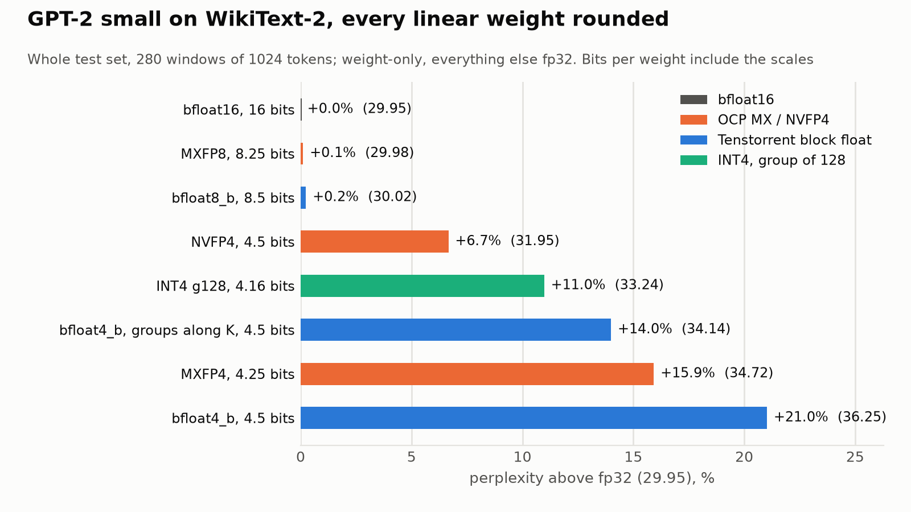

# GPT-2 on WikiText-2 with low-bit weights: Tenstorrent's block floats next to MX, NVFP4 and INT4

TensixFuse's GPT-2 study ran each MLP block on its own on a simulated Blackhole chip and reported how closely its output tracked fp32 (PCC). That tells you which blocks a format hurts, not what the model loses end to end. So I measured perplexity on the whole WikiText-2 test set with the weights rounded exactly the way each format stores them, and put Tenstorrent's bfloat8_b and bfloat4_b next to the other low-bit formats people use now: OCP's MXFP8 and MXFP4, NVIDIA's NVFP4, and INT4 with one scale per 128 weights.

The short version: at 8 bits nothing matters. At 4 bits, bfloat4_b is the weakest of the four formats, about half of that is which axis its groups run along, and on a Llama-style model Tenstorrent's own "performance" recipe costs 8% in perplexity.

## Setup

- **Model:** GPT-2 small (124M parameters), `openai-community/gpt2`.
- **Data:** the WikiText-2 raw test set, joined with blank lines: 287,644 tokens, scored in 280 non-overlapping windows of 1,024 tokens, the protocol quantization papers usually report.
- **What's rounded:** weights only. "MLP" is `c_fc` and `c_proj` in all 12 blocks, the weights the per-block study ran on ttsim; "every linear weight" adds attention's `c_attn` and `c_proj`. Embeddings, LayerNorm, biases, the LM head and all activations stay fp32.
- **Where it ran:** on CPU in CI ([`perplexity.yml`](../.github/workflows/perplexity.yml)), five runners in parallel, about 11 minutes per format. Running GPT-2 on ttsim for 287k tokens would take days, and the per-block study already showed that this emulation of tt-metal's packer predicts the simulated chip's PCC to the 5th decimal.

| Format | Values per group | Scale | Bits per weight | Grouped along |
|---|---|---|---|---|
| bfloat8_b | 16 | shared 8-bit exponent | 8.5 | N (a tile row of the [K, N] weight) |
| bfloat4_b | 16 | shared 8-bit exponent | 4.5 | N |
| MXFP8 (E4M3) | 32 | power of two (E8M0) | 8.25 | K |
| MXFP4 (E2M1) | 32 | power of two (E8M0) | 4.25 | K |
| NVFP4 (E2M1) | 16 | FP8 E4M3, under one FP32 scale per tensor | 4.5 | K |
| INT4 g128 | 128 | FP16 scale and 4-bit zero point | 4.16 | K |

Tenstorrent's formats group along a row of a 32×32 tile. For `ttnn.linear`'s weight, laid out [K, N], that's 16 output features sharing an exponent. The others group along K, the reduction dimension, the way their specs and the usual kernels lay out a matmul weight. To see whether the axis matters, `bfloat4_b, along K` stores the same weight transposed, so its groups also run along K.

The non-Tenstorrent formats are emulated from their specs with plain round-to-nearest. Nothing is calibrated: GPTQ, AWQ and NVIDIA's NVFP4 recipes tune scales or weights on data and would do better than these rows. The block floats don't get any tuning either.

## Results

fp32 perplexity is 29.951.

| Format | Bits per weight | MLP only | Every linear weight |
|---|---|---|---|
| bfloat16 | 16 | 29.950 (-0.00%) | 29.950 (-0.00%) |
| MXFP8 | 8.25 | 29.821 (-0.43%) | 29.985 (+0.11%) |
| bfloat8_b | 8.5 | 29.967 (+0.06%) | 30.023 (+0.24%) |
| NVFP4 | 4.5 | 30.872 (+3.08%) | 31.947 (+6.67%) |
| INT4 g128 | 4.16 | 31.572 (+5.41%) | 33.241 (+10.98%) |
| bfloat4_b, along K | 4.5 | 31.895 (+6.49%) | 34.143 (+14.00%) |
| MXFP4 | 4.25 | 30.669 (+2.40%) | 34.720 (+15.93%) |
| bfloat4_b | 4.5 | 32.470 (+8.41%) | 36.249 (+21.03%) |

Mixed MLP splits (6.5 bits per MLP weight): bfloat8_b `c_fc` with bfloat4_b `c_proj` gives 30.742 (+2.64%); bfloat4_b `c_fc` with bfloat8_b `c_proj` gives 31.441 (+4.98%).

<picture>
  <source media="(prefers-color-scheme: dark)" srcset="img/perplexity-dark.png">
  
</picture>

## tt_transformers' recipes on a Llama-style model

Tenstorrent's `tt_transformers` (in tt-metal, `models/tt_transformers/tt/model_config.py`) keeps every linear weight in bfloat8_b by default. Its "performance" setting moves the MLP's FF1 and FF3 (gate and up projections) to bfloat4_b with LoFi, except on Qwen2.5-7B, Qwen2.5-VL-7B and olmOCR-2-7B, which its config says are degraded under that setting. I ran the same emulation on Qwen2.5-0.5B, a small model of that family with a gated SiLU MLP: 299,078 tokens, 292 windows.

| Recipe | Bits per weight | Perplexity | vs fp32 |
|---|---|---|---|
| fp32 (the checkpoint is bf16, so bf16 is the same) | 32 | 14.651 | |
| default: every linear weight bfloat8_b | 8.5 | 14.669 | +0.13% |
| performance: FF1/FF3 bfloat4_b, the rest bfloat8_b | 6.16 | 15.816 | +7.96% |
| every MLP weight bfloat4_b | 4.99 | 16.749 | +14.32% |

## What I take from it

1. **8 bits is free on these models.** No 8-bit format costs more than a quarter of a percent, on GPT-2 or on Qwen. MXFP8 on the MLP even came out 0.4% below fp32, which I read as luck, not a gain.
2. **bfloat4_b is the weakest 4-bit format here.** At the same 4.5 bits per weight, NVFP4 costs 6.7% and bfloat4_b 21.0% with every linear weight rounded. Both use groups of 16. The difference is what each group gets: NVFP4 has a fine-grained FP8 scale and floating-point elements, so small values keep relative precision. bfloat4_b has a power-of-two exponent and 3 bits of mantissa measured against the largest value in the group, so a weight 16× smaller than its group's largest is stored as zero. The per-block study found 15 to 19% of GPT-2's weights end up exactly zero in bfloat4_b.
3. **The axis is about half of it.** Stored the usual way, a bfloat4_b exponent is shared by 16 output features. Grouping the same format along the input dimension instead cuts the damage from +21.0% to +14.0%, about half of the gap to NVFP4. On a Tenstorrent chip that's a layout choice (storing the weight transposed), not a new format, though I haven't checked what it costs the matmul.
4. **Which layer gets the 4 bits matters, and it's model-specific.** On GPT-2, bfloat4_b in `c_proj` costs about half what it costs in `c_fc` (2.6% against 5.0%), the same answer the per-block PCCs gave, and the opposite of where tt_transformers puts its bfloat4_b. On Qwen2.5-0.5B, tt_transformers' performance recipe costs 8%, while its default costs 0.13%: the small Qwen degrades under that recipe too, as tt_transformers' own config says the 7B does.
5. **MXFP4 does well on the MLP (+2.4%) and badly on everything (+15.9%),** so attention's weights do most of its damage. My guess, which I haven't checked: MX rounds each block's scale down to a power of two, so a block's largest value can land past FP4's top and get clamped, and attention's projections have more of those blocks.

## Caveats

- Weight-only. On a Tenstorrent chip the activations would be bf16 and every multiply would run at some math fidelity. LoFi isn't in this table, because the CPU emulation can't model it; its per-block cost is in the [fidelity sweep](../README.md#2-block-float-weights-on-gpt-2s-mlps).
- Plain round-to-nearest for every format. Calibrated methods would narrow the 4-bit gaps, and could change their order.
- Two small models. Bigger LLMs have larger outliers, and formats with a shared exponent per small group should suffer more there.
- One run per format. CPU PyTorch isn't bit-reproducible across CPU types, so the last digit can move between runs; the gaps between formats are much bigger than that.

## Reproduce

```bash
pip install torch --index-url https://download.pytorch.org/whl/cpu
pip install transformers datasets && pip install -e .
python bench/perplexity.py --configs fp32,all:bfloat8_b,all:bfloat4_b --out ppl.json
python bench/perplexity_llama.py --configs fp32,attn=bfloat8_b+ff13=bfloat4_b+ff2=bfloat8_b --out qwen.json
```

The emulation is in [`src/tensixfuse/formats.py`](../src/tensixfuse/formats.py) and [`blockfloat.py`](../src/tensixfuse/blockfloat.py); its edge cases are pinned in [`tests/test_formats.py`](../tests/test_formats.py). The JSON these tables come from is [`results/perplexity.json`](../results/perplexity.json) and [`results/perplexity_qwen.json`](../results/perplexity_qwen.json).
